## <h1 align="center">1. Project Overview</h1>
The goal of this project was to analyze 14,174 online store orders from 2025 using Pivot Tables and Excel charts. The analysis focuses on sales performance across product categories, sales channels, and time periods to identify key business trends and insights.

## <h1 align="center">2. Dataset Description</h1>
•	14,174 orders 
•	6 product categories 
•	4 sales channels 
•	Full year of sales (2025) 

## <h1 align="center">3. Business Questions</h1>
•	Which category generated the highest sales value? 
•	Which category received the highest number of orders? 
•	How did sales change over time? 
•	What share of total sales came from each sales channel? 
•	Which category had the highest and lowest average order value? 
•	Which month showed a significant sales spike? 
•	Does the sales channel structure differ across categories? 

## <h1 align="center">4. Analysis & Visualizations</h1>

## •	Which category generated the highest sales value?

  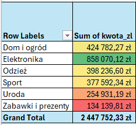

 

  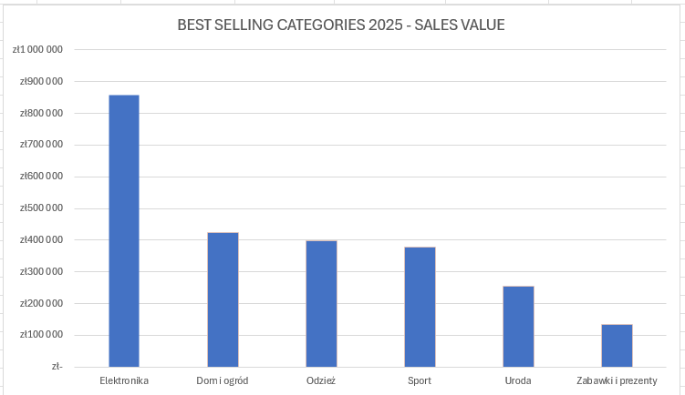

Elektronika generated the highest sales revenue in 2025, while Zabawki i prezenty generated the lowest revenue. Uroda also achieved relatively low sales compared to the other categories.
This shows that sales performance differs significantly across product categories.

Revenue is an important measure of category performance, but it does not provide information about profitability. To better evaluate category performance, the company should collect product cost data in the future. This would make it possible to calculate profit margins and identify the most profitable categories.
Based on the available data, Elektronika appears to be one of the strongest categories. The company should continue investing in this category and look for opportunities to further increase sales and customer demand.
 
## •	Which category received the highest number of orders?

 

  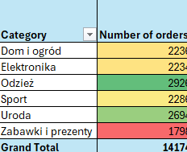

 

  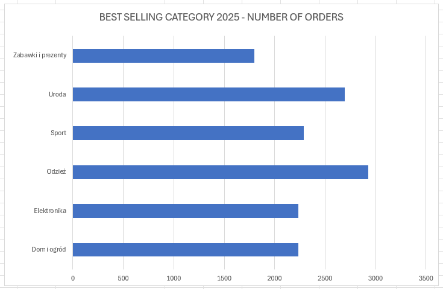

Odzież received the highest number of orders in 2025 (2926), while Zabawki i prezenty received the lowest number of orders (1978).
An interesting finding is that Elektronika generated the highest revenue despite not having the highest order volume. This suggests that customers tend to spend more per transaction when purchasing products from the Elektronika category.
Odzież appears to be an important category because it combines a high order volume with strong overall sales performance.
Further analysis should focus on understanding customer purchasing behavior in the Odzież category and identifying opportunities to increase the average order value.

## •	How did sales change during the year?

 

  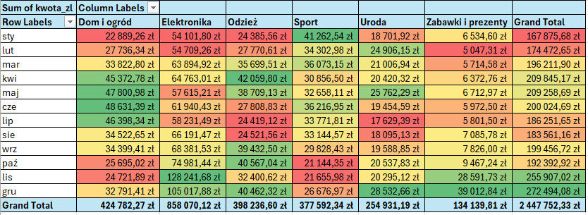

  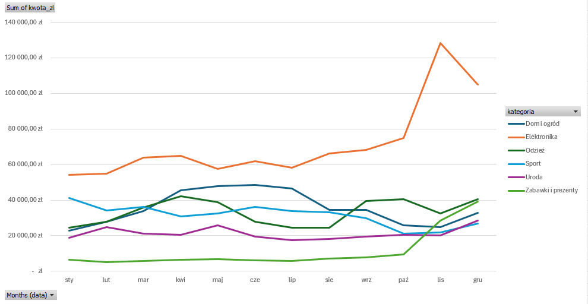

Sales patterns differ across categories, showing that customer demand changes throughout the year.

Elektronika
Sales in the Elektronika category peaked in November and December, while the lowest sales were recorded in January and February.
The strong performance at the end of the year may be related to increased consumer spending during the holiday season.
Recommendation
The company should ensure that inventory levels are sufficient before the peak season and maintain effective marketing activities during periods of high demand. Additional attention should be given to weaker months to identify opportunities for promotional campaigns.

Odzież
Observation
Sales in the Odzież category showed several peaks throughout the year, particularly in April, October, and December. The lowest sales levels were recorded in January, February, and June.
Compared to Elektronika, sales in the Odzież category were more evenly distributed throughout the year.
Recommendation
The company should investigate the reasons behind weaker sales periods and consider seasonal promotions to improve performance during months with lower demand. To better understand sales diffrences throughout the year, the company should consider collecting inventory data. This would help assess stock levels and identify potential overstock or understock situations.
  

## •	What share of total sales came from each sales channel?

  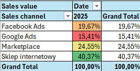

  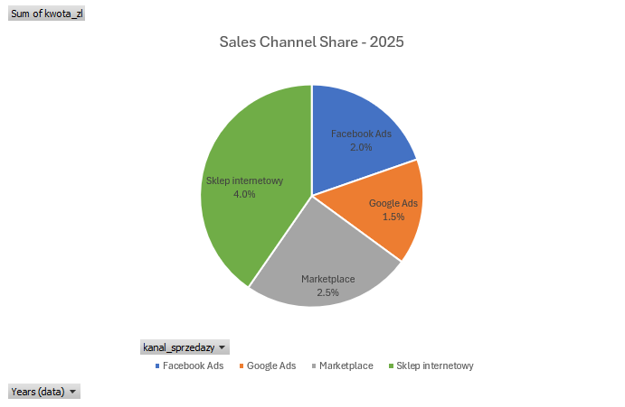

The online shop was the leading sales channel in 2025, generating 40.37% of total sales revenue. Marketplace was the second most important channel, accounting for 24.55% of total sales. Google Ads contributed the smallest share, representing only 15.41% of total sales revenue.
Recommendation
The results suggest that the online shop is the company's most important sales channel and should remain a key focus area.
However, revenue alone does not provide enough information to evaluate channel performance. To better understand the effectiveness of each channel, the company should also collect marketing cost data. This would make it possible to calculate return on investment (ROI) and identify the most profitable sales channels.
Additionally, collecting more detailed data about purchased products and customer behavior could help identify cross-selling opportunities and improve future marketing strategies.
  
## •	Which category has the biggest AOV (average order value)?

  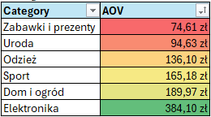

  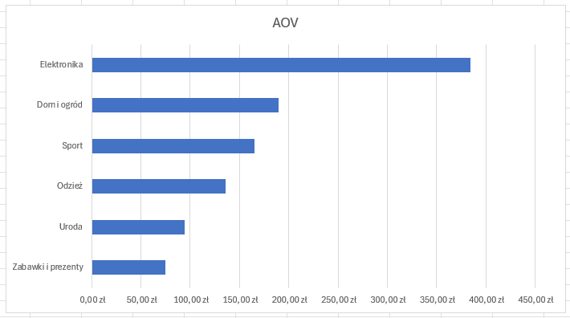

Elektronika recorded the highest Average Order Value (AOV), while Zabawki i prezenty had the lowest AOV.
This explains why Elektronika generated the highest revenue despite receiving fewer orders than Odzież. Customers purchasing products from the Elektronika category tend to spend significantly more per order.
The results indicate that revenue growth can be achieved either through a higher number of orders or through a higher average order value.
Future analysis should include product cost data to determine whether the high AOV in Elektronika also results in higher profitability. 

  
## •	Which month showed a significant sales spike?

  

December was the strongest sales month in 2025, generating 272,494 PLN in revenue. January was the weakest month, with sales of 167,875 PLN.
The significant increase in sales during December suggests a strong seasonal effect at the end of the year.
Recommendation
The company should prepare for the increased demand during the holiday season by ensuring sufficient inventory levels, staffing, and marketing support.
To improve results during weaker periods, the business could consider promotions, loyalty programs, or special offers designed to increase customer activity throughout the year.

## •	Does the sales channel structure differ across categories? 

  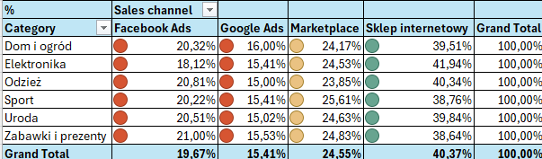

  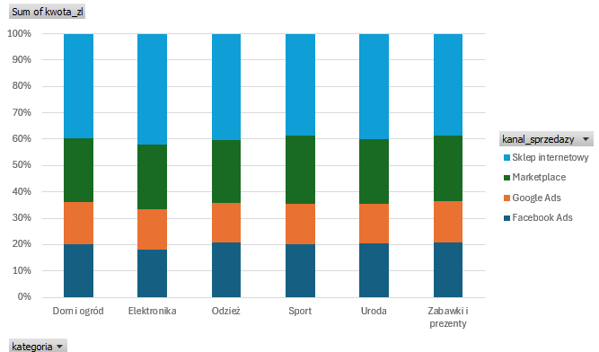

The sales channel structure is relatively similar across all categories. The online shop generated the largest share of sales in every category, while Google Ads consistently delivered the lowest share.
Although some small differences can be observed between categories, no category relies heavily on a single channel. This indicates a balanced sales distribution across the available channels.

<h1 align="center">📌 Final Conclusions & Recommendations</h1>

## Key Findings

✅ The Electronics category generated the highest revenue and appears to be one of the strongest-performing categories.

✅ The Clothing category recorded the highest number of orders, indicating strong customer demand.

✅ Revenue distribution differed significantly across product categories and sales channels, creating opportunities for further optimization.

✅ Google Ads generated the lowest share of revenue among the analyzed sales channels and should be reviewed in more detail.

---

## Business Recommendations

### 📱 Electronics Category

The Electronics category should be investigated further due to its strong revenue performance. However, sales data alone is not sufficient to determine profitability.

The company should start collecting:

- Product costs
- Inventory data
- Stock level history
- Inventory holding costs

This would enable future analysis of:

- Profit margin by product
- Profit margin by category
- Profitability of Electronics products
- Inventory turnover efficiency

---

### 👕 Clothing Category

The Clothing category generated the highest number of orders and represents an important growth area.

Recommended actions:

- Analyze seasonal demand patterns
- Review marketing performance during weaker months
- Increase promotional efforts when sales decline
- Ensure sufficient inventory levels before peak sales periods

---

### 📊 Data Collection Improvements

To support more advanced business analysis, the company should begin collecting additional operational and financial data:

- Product costs
- Stock levels
- Inventory turnover metrics
- Inventory holding costs
- Marketing expenses
- Marketplace commissions
- Advertising costs by channel

---

### 📢 Sales Channel Analysis

Although Google Ads generated the lowest revenue contribution, revenue alone is not enough to evaluate channel performance.

Future analysis should include:

- Advertising costs
- Conversion rates
- Customer Acquisition Cost (CAC)
- Return on Ad Spend (ROAS)

This would make it possible to identify the most profitable sales channels and determine whether some channels should be optimized or discontinued.

---

## Future Analysis Opportunities

Once additional data becomes available, the following analyses could be performed:

- Profit margin analysis
- Category profitability analysis
- Customer Acquisition Cost (CAC)
- Channel profitability analysis
- Inventory turnover analysis
- Product profitability ranking
- Replenishment and inventory planning optimization

---

## Final Note

The current analysis provides valuable insights into sales performance and customer purchasing behavior. However, combining sales data with inventory, cost, and marketing information would provide a much more complete view of business performance and support better strategic decision-making.
